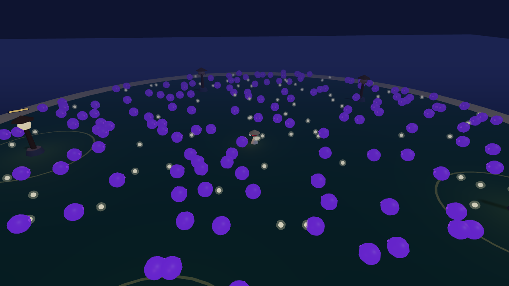

# Đảo Đèn Lồng (Lantern Island) — v1.0.0

> **🎬 Video Demo (< 5 phút):** [Xem video demo tại Release v1.0.0](https://github.com/haanh293/K5-L3A-DAY12-NguyenHaAnh-2A202603605-AI-SDLC-Dao-Den-Long/releases/tag/v1.0.0) *(hoặc `docs/demo/demo.mp4`)*
>
> Game 3D góc nhìn thứ ba qua **3 Đêm (Đảo Bến · Đảo Cau · Đảo Chuông)**. Người chơi điều khiển **Mây**, người giữ đèn đội nón lá treo đèn lồng nhỏ, thu thập đom đóm để thắp sáng, châm dầu và **giữ đảo sáng (`≥ 60%` đèn)** trước Bóng Mực hút dầu và Gió Lạc cho tới bình minh.



---

## Yêu cầu hệ thống

- **Node.js ≥ 20** (tương thích macOS, Linux, Windows).
- Trình duyệt hỗ trợ **WebGL2** (Chrome / Chromium / Edge / Firefox / Safari). Chế độ benchmark tự động cần Chrome / Chromium / Edge (có thể chỉ định bằng biến môi trường `CHROME_PATH`).

---

## Cài đặt & Chạy (tối đa 3 lệnh)

```bash
npm install
npm run build
npm run preview
```

Mở trình duyệt tại **`http://localhost:4173`**. Bảng xếp hạng cục bộ được lưu tự động vào `data/leaderboard.json`.

---

## Điều khiển mặc định *(đổi được toàn bộ trong Cài đặt)*

| Phím / Thao tác | Hành động |
|---|---|
| `W` `A` `S` `D` (hoặc `↑` `↓` `←` `→`) | Di chuyển theo camera (`6.0 m/s`; `7.2 m/s` khi có Bùa Gió) |
| `Space` | Nhảy (`7.0 m/s`, trọng lực `-20 m/s²`) |
| `Shift` | **Lướt (Dash)** (`14 m/s` trong `0.2s`, hồi `1.5s`, giữ độ cao khi trên không) |
| `E` | Nạp ánh sáng (`10` đom đóm thắp mới / `5` thắp lại) hoặc **châm dầu** (`+10` dầu/đom đóm) |
| `F` | **Tỏa Sáng (Pulse)** (tốn `3` đom đóm, bán kính 3D `5m`, hồi `3s`, choáng `120 tick`, đẩy `4m`) |
| Kéo chuột trái hoặc `J` / `L` | Xoay camera (chỉnh độ nhạy trong Cài đặt) |
| `Esc` hoặc `P` | Tạm dừng (dừng hoàn toàn logic, mở Cài đặt / Đổi phím / Dễ tiếp cận) |

---

## Luật chơi & Cách tính điểm (`game.contract.json` v1.3)

- **Thắng (`dawn_survived`):** Sống sót tới bình minh với `≥ 60%` đèn đang sáng — Đêm 1 (`240s`, `≥ 3/5`), Đêm 2 (`270s`, `≥ 4/6`), Đêm 3 (`300s`, `≥ 5/7`).
- **Nhiên liệu đèn:** Tối đa `100`, hao `1.0/s` (tính bằng số nguyên `1/60`). Khi `fuel < 30`, đèn mất vùng an toàn `6m`, nhấp nháy `1 Hz`, và Bóng Mực `wander` sẽ tiến lại **hút dầu (`drain`, `-5/s`)**. Hết dầu đèn tắt (`ever_lit = true`), thắp lại cần `5` đom đóm.
- **Sức chứa tăng dần:** `10 + 2 × số lần thắp thành công trong Đêm` (tối đa `20`).

| Sự kiện | Điểm |
|---|---:|
| Mỗi đom đóm nạp vào đèn (thắp mới / thắp lại / châm dầu) | `+5` |
| Thắp đèn lần đầu (`relight: false`) | `+100` |
| Thắp lại đèn đã từng sáng (`relight: true`) | `+40` |
| Bóng Mực trúng Tỏa Sáng (`pulse`) | `+5` (hoặc **`+15`** nếu đang `drain`) |
| Bình minh (chỉ khi thắng): mỗi đèn sáng / mỗi Ngọn Lửa còn | `+(50 + floor(fuel))` / `+50` |

---

## Dễ tiếp cận (Accessibility) & Bảng xếp hạng

- **Đổi phím:** Đổi được toàn bộ 9 hành động trong *Cài đặt*, tự phát hiện & báo trùng phím, có nút *Khôi phục mặc định* (lưu `localStorage`).
- **Chế độ mù màu (*Bảng màu dễ phân biệt*):** Bóng Mực đổi viền/mắt `#7A3CFF → #00B3FF`, cảnh báo UI `#FF5A5F → #FFFFFF` kèm `⚠`. Đèn tắt xẹp `20%` kèm vết rách phân biệt không cần màu.
- **Phụ đề & chỉ báo hình ảnh:** Bóng Mực xuất hiện (kèm mũi tên mép màn hình), gió sắp thổi, đếm ngược `10s` cuối, đèn `fuel < 30`.
- **Giảm chuyển động & Cỡ chữ:** Tắt rung camera / chớp màn hình; cỡ chữ tối thiểu `18px` ở `1280×720` kèm tùy chọn **Chữ lớn (×1.25)**.
- **Bảng xếp hạng cục bộ:** Top 10 lưu trên đĩa (`data/leaderboard.json`), hỗ trợ tiếng Việt có dấu (`3–12` ký tự), xem từ menu chính và xuất JSON qua CLI.

---

## Kiểm thử, Headless, Benchmark, Soak & Export (Contract v1.3)

```bash
# Chạy toàn bộ build + 28 unit/regression/v1.3 tests + headless scenarios + soak 10 Đêm + determinism
npm run verify

# Chạy trực tiếp chế độ headless (Đêm 1, 2 hoặc 3)
node dist-headless/headless/cli.js --seed 42 --night 3 --ticks 1800 --snapshot-every 60 --out tmp/out.jsonl

# Chạy benchmark chuẩn (1280×720, 200 Shades, 100 Motes, tắt vsync, 3s warmup + 30s đo)
node scripts/bench.mjs --seed 42 --duration 30 --out bench.json

# Chạy soak test 10 Đêm liên tiếp (kiểm tra crash & rò rỉ bộ nhớ RSS)
node --expose-gc scripts/soak.mjs --seed 7 --nights 10 --out soak.json

# Xuất bảng xếp hạng cục bộ ra JSON
node scripts/run-app.mjs --export-leaderboard out.json
```

> **Ghi chú về VSync trong Benchmark:** `scripts/bench.mjs` khởi chạy Chrome/Chromium/Edge với cờ `--disable-frame-rate-limit --disable-gpu-vsync` nên `vsync_off: true`. Kết quả tự đo trên máy phát triển ([bench.json](bench.json)): `avg_fps = 535.5`, `p1_low_fps = 236.9`, `frame_ms_p95 = 2.8 ms`, `load_ms = 829 ms`.

---

## Tài liệu dự án & Bằng chứng SDLC

- Hợp đồng chuẩn: [game.contract.json](game.contract.json) (`contract_version: "1.3"`)
- Kết quả đo thực tế: [bench.json](bench.json) · [soak.json](soak.json)
- Quyết định thiết kế (ADR) & Changelog: [docs/notes/ADR-001-lantern-fuel-and-dawn-win.md](docs/notes/ADR-001-lantern-fuel-and-dawn-win.md) · [CHANGELOG.md](CHANGELOG.md)
- Retrospective & Nhật ký AI: [docs/notes/RETRO.md](docs/notes/RETRO.md) · [docs/notes/ai-log.md](docs/notes/ai-log.md)
- Bằng chứng 4 phase: [Phase 1](docs/proof/phase-1/README.md) · [Phase 2](docs/proof/phase-2/README.md) · [Phase 3](docs/proof/phase-3/README.md) · [Phase 4](docs/proof/phase-4/README.md)
- Bản quyền & Nguồn: [CREDITS.md](CREDITS.md) · [LICENSE](LICENSE) · Harness AI: [AGENTS.md](AGENTS.md)

---

## Sáng tạo của tôi

Mọi yếu tố sáng tạo đều được cô lập hoàn toàn trong `src/client/` và **tắt tự động** trong cảnh Benchmark/Soak/Headless để không ảnh hưởng số đo hay đầu ra Contract:

1. **Mây với nón lá, đèn lồng treo vành nón & đom đóm bay quanh người**, cùng bến gỗ + thuyền nhỏ đặc trưng Đảo Bến, chuông vàng Tháp Chuông Đảo Chuông và hạt lá bay theo hướng gió mạnh Đêm 3.
2. **Trực quan hóa nhiên liệu & Dễ tiếp cận:** Đèn tắt xẹp 20% có vết rách giấy, thanh dầu 3D xoay theo camera, nhấp nháy 1 Hz khi yếu, chế độ mù màu, giảm chuyển động và chữ lớn `×1.25`.
3. **Âm thanh Web Audio tự sinh hoàn toàn:** Nhạc nền đêm ngũ cung + đủ bộ hiệu ứng âm thanh (không cần tải asset ngoài).

**Bằng chứng không phá phần lõi:** `npm run verify` đạt **28/28 tests xanh**, trọn Đêm 3 headless chạy trong `143 ms` và giống hệt từng byte qua 2 lần chạy (`57.375 bytes`), Soak 10 Đêm `crashes = 0` (`1.03×` RSS), Benchmark 30s đạt `535.5 avg FPS` / `236.9 p1_low FPS`.
