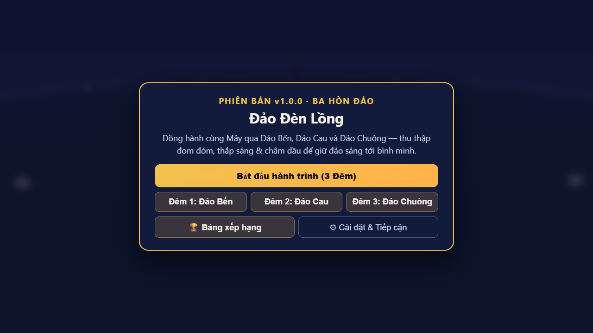
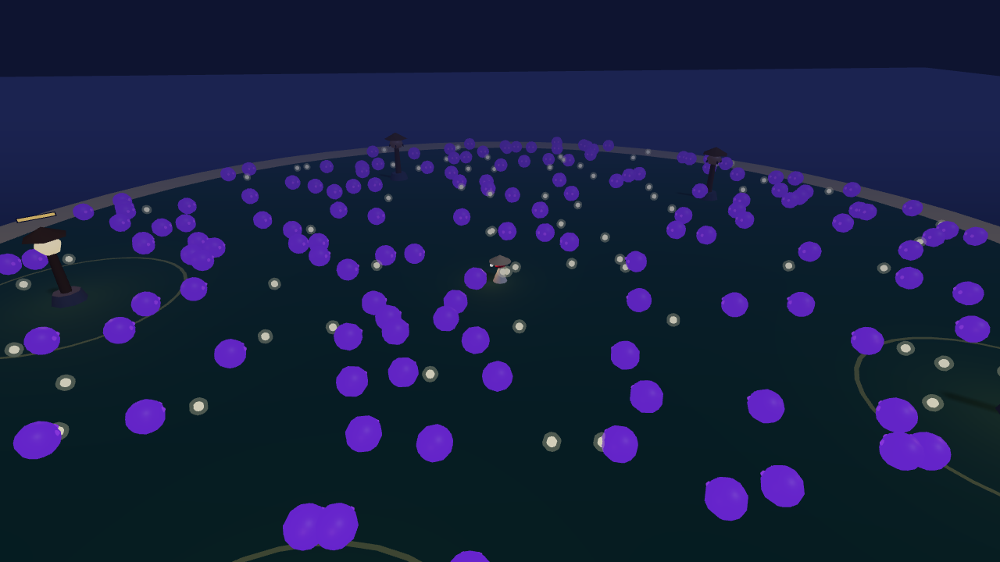

# Bằng chứng kiểm chứng — Phase 4 (v1.0.0 · Contract v1.3)

Mọi bằng chứng dưới đây được đo và sinh tự động trên mã nguồn tại tag `phase-4` / Release `v1.0.0` (không sửa tay).

## Cấu hình máy tự đo tham khảo
- **OS:** Windows 11 (`win32 10.0.22631 x64`)
- **Runtime:** Node.js `v24.11.1`, Google Chrome (WebGL2 / ANGLE Direct3D11)
- **GPU:** AMD Radeon(TM) 780M (tích hợp)

## Bảng truy vết Yêu cầu → Bằng chứng

| Mã | Yêu cầu (Ticket-04 / Contract v1.3) | Cách kiểm chứng | Kết quả đo / Bằng chứng | Kết quả |
|---|---|---|---|---|
| BENCH | Chế độ benchmark chuẩn (`1280×720`, `200` Shades `wander`, `100` Motes, `L1–L3` sáng fuel 100, camera quỹ đạo `r=30m, Y=15m`, `3s` warmup + `30s` đo, tắt sáng tạo thêm) | `node scripts/bench.mjs --seed 42 --duration 30 --out bench.json` | [bench.json](../../../bench.json): `avg_fps = 535.5` (≥ 60), `p1_low_fps = 236.9` (≥ 30), `frame_ms_p95 = 2.8 ms`, `frames = 16066`, `load_ms = 829 ms` (≤ 10.000), `vsync_off = true` | Đạt |
| SOAK | Soak test 10 Đêm liên tiếp (`seed = 7 + i`, input ngẫu nhiên theo seed, `crashes = 0`, `mem_end ≤ 1.2 × mem_start`) | `node --expose-gc scripts/soak.mjs --seed 7 --nights 10 --out soak.json` | [soak.json](../../../soak.json): `nights = 10`, `crashes = 0`, `mem_start_mb = 55.7`, `mem_end_mb = 57.2` (`1.03× ≤ 1.20×`), `duration_s = 0.2s` | Đạt |
| LB | Bảng xếp hạng cục bộ (top 10, tên `3–12` ký tự + tiếng Việt, lưu đĩa cục bộ `data/leaderboard.json`, sắp xếp `score DESC` / `achieved_at ASC`, lệnh `--export-leaderboard`) | `tests/phase4.test.ts` + `node scripts/run-app.mjs --export-leaderboard` | 3/3 unit & CLI export tests pass | Đạt |
| A11Y | Dễ tiếp cận: đổi phím 9 hành động + báo trùng phím + khôi phục mặc định; phụ đề/chỉ báo hình ảnh (Bóng Mực + mũi tên mép, gió, 10s cuối, đèn `<30%`); giảm chuyển động; cỡ chữ `≥ 18px` ở `1280×720` + chữ lớn `×1.25` | Rà soát `index.html`, `src/client/style.css`, `src/client/main.ts` + ảnh chụp `1280×720` | `screenshot-menu.png`, `screenshot-bench.png`, build `dist/` xanh | Đạt |
| REG-P13 | Hồi quy toàn bộ Phase 1–3 + Contract v1.3 + Determinism | `npm run verify` | **28/28 tests pass**, Phase 3 headless scenarios pass, Night 3 determinism giống từng byte (`57.375 bytes`) | Đạt |
| DOCS | `README.md`, `CHANGELOG.md` (4 phase), `CREDITS.md`, `LICENSE`, `RETRO.md`, gói Release `v1.0.0` | Rà soát repo + `node scripts/package-release.mjs` | Đủ toàn bộ tài liệu & bản đóng gói `dao-den-long-v1.0.0.zip` | Đạt |

## Ảnh chụp thật ở `1280×720`





## Lệnh tái lập

```bash
npm install
npm run build
npm run verify
npm run bench
```
